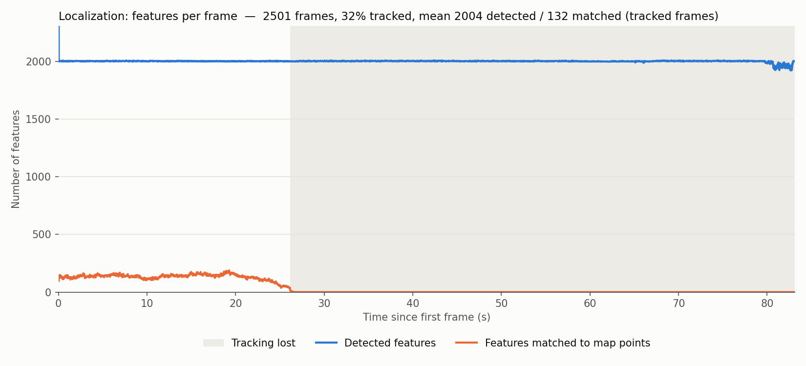
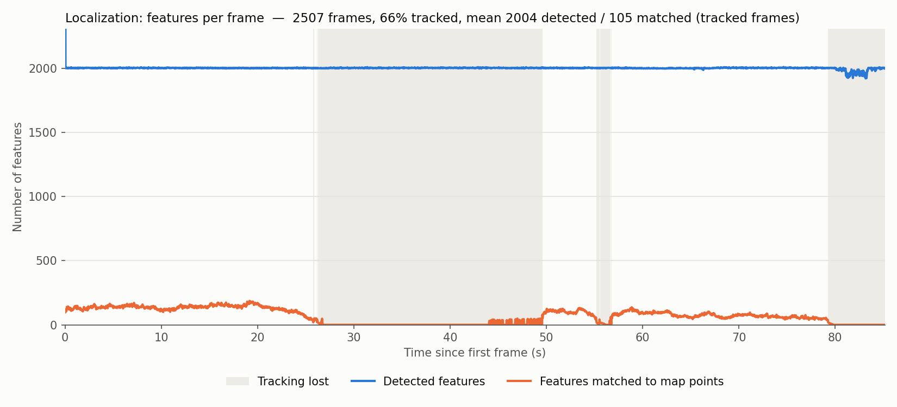
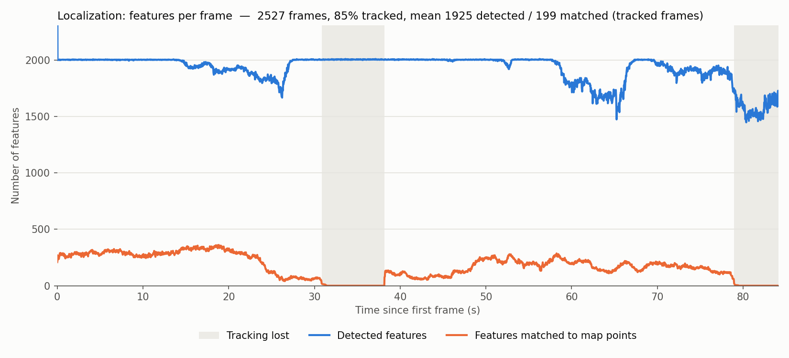
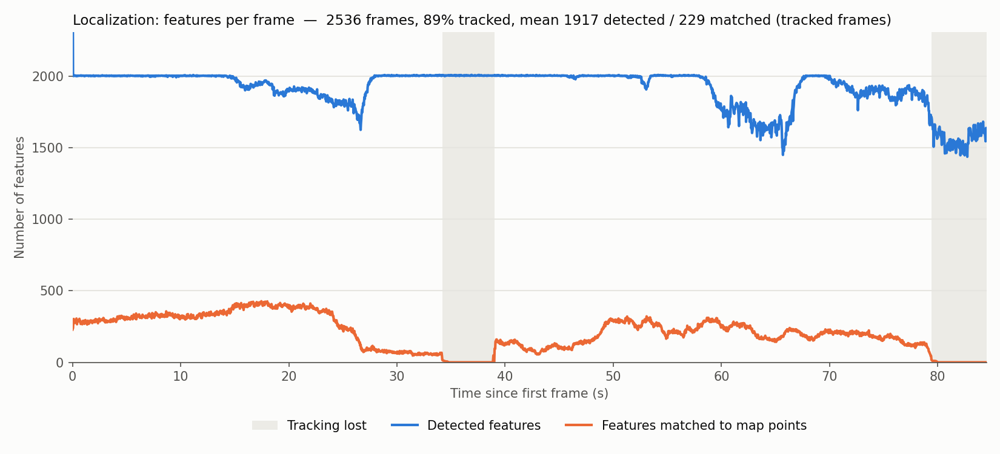
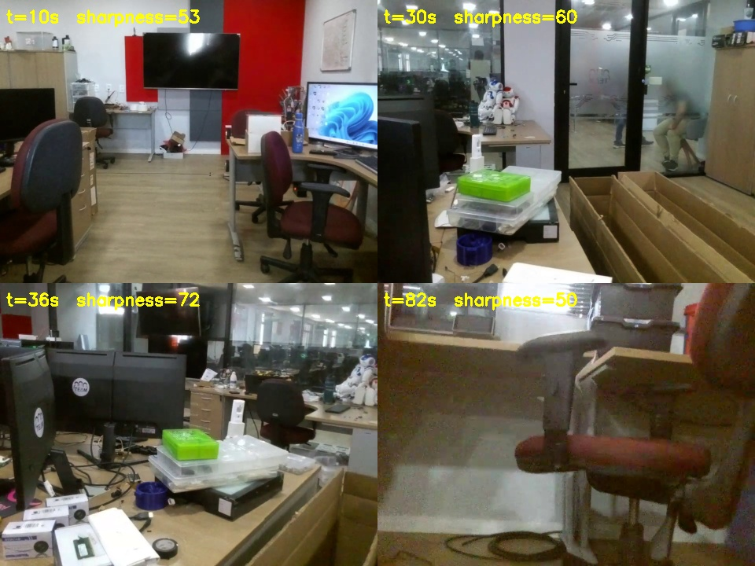

# Localization results: `tello_alpha` against `map_rgbd_03`

> `map_rgbd_03` was built with the TUM Kinect calibration and
> `RGBD.DepthMapFactor: 5000`, so it is 5x too small. See
> [`../tello_alpha_vs_map_rgbd_04`](../tello_alpha_vs_map_rgbd_04/README.md)
> for the corrected, metric map.

Monocular localization of the `tello_alpha` drone bag (2577 frames, ~85 s)
against the Kinect RGB-D atlas `map_rgbd_03`, run with `--localize-only`.
Each step adds one fix on top of the previous one.

| # | Setup | Tracked frames | Mean matched features (tracked frames) |
|---|---|---|---|
| 1 | Upstream ORB_SLAM3, `tello.yaml` | 32% | 132 |
| 2 | + fork: relocalization in localization-only mode | 66% | 105 |
| 3 | + `Camera.newWidth/newHeight` resize to Kinect pixel scale | 85% | 199 |
| 4 | + `tello_02` calibration (`tello_kinect_scale.yaml`) | **89%** | **229** |

Step 2's mean matched count drops because it includes the low-match frames
right after relocalizing that step 1 never reached. Step 4 gave identical
numbers in two repeated runs.

## Reading the plots

- **Detected features (blue):** ORB keypoints extracted per frame, capped at
  `ORBextractor.nFeatures` (2000). Below the cap the image has fewer corners
  (low texture, blur). Depends only on the image.
- **Features matched to map points (orange):** keypoints associated with a 3D
  point of the Kinect map that survived pose optimization as inliers. This is
  what localizes the camera; monocular tracking fails below ~30 inliers.
- **Tracking lost (gray):** frames whose tracking state is not `OK`
  (`RECENTLY_LOST` here, i.e. trying to relocalize).
- **X axis:** seconds since the first frame. The bag has zero header stamps,
  so the node uses the receive time (30 fps, no gaps).
- The first frame uses ORB_SLAM3's initializer extractor (more features); the
  Y axis is clipped so it does not flatten the rest.

## Plots

1. Baseline: tracking is lost at 26 s and never recovers. In localization-only
   mode the tracker stayed `RECENTLY_LOST` forever (the transition to `LOST`,
   which triggers relocalization, only existed in SLAM mode).

   

2. Relocalization fix: still lost at 26 s, but relocalizes at 49.6 s and
   again after a brief loss at 55-57 s.

   

3. Image resized to the Kinect pixel scale: Tello fx ~901 vs Kinect fx ~517,
   i.e. ~3 ORB pyramid levels apart. ORB_SLAM3 predicts a map point's pyramid
   level from its distance only, so most matches were searched at the wrong
   level. Fewer detections (smaller image), but ~2x more matches.

   

4. `tello_02` calibration: `tello.yaml`'s distortion (k2=-2.68, k3=10.06)
   shifts the image corners by ~240 px; `tello_02` stays under 7 px. More
   matches near the image borders.

   

## Remaining losses (setup 4)



Frames from the bag at 10 s (well tracked), 30 s (matches dropping), 36 s
(lost) and 82 s (lost); "sharpness" is the variance of the Laplacian (bag
median 226).

- **34-39 s:** not caused by blur; no frame between 25 and 40 s is blurred and
  detections stay at 2000. Matches decay gradually from ~350 (25 s) to ~50
  (34 s) while the camera turns (inter-frame difference doubles) towards a
  glass wall with the office behind it, moving people and plain cardboard.
  Likely causes: the region is poorly covered by the map, far background
  beyond the Kinect depth range (~0.5-4.5 m) has no map points, and the
  viewpoint differs from the mapping run. Relocalizes at 39 s.
- **79-85 s:** 39 genuinely blurred frames (sharpness down to 20) with the
  camera very close to a chair, below the Kinect minimum depth. Detections
  fall to ~1550 and nothing matches until the bag ends.
- Only ~12% of detected features match the map even when tracking is good:
  different sensors and H.264 compression change ORB descriptors, the map only
  holds points triangulated in keyframes, and far points have no depth. 200-400
  inliers is still plenty for ORB_SLAM3.

Mapping the glass-wall area with the Kinect from drone-like viewpoints is the
most likely way to remove the 34 s loss.

## Reproducing

```bash
ros2 run ros2_orbslam3 mono \
  /home/dev/ORB_SLAM3/Vocabulary/ORBvoc.txt \
  /home/dev/config/tello_kinect_scale.yaml \
  --load-map /home/dev/maps/map_rgbd_03/map.osa \
  --localize-only \
  --features-csv /home/dev/maps/localization_features.csv \
  --ros-args -p image_topic:=/tello/camera
# in another shell
ros2 bag play /home/dev/bags/tello_alpha
```

Re-plot any CSV here with
`ros2 run ros2_orbslam3 plot_features.py <file.csv>`.
