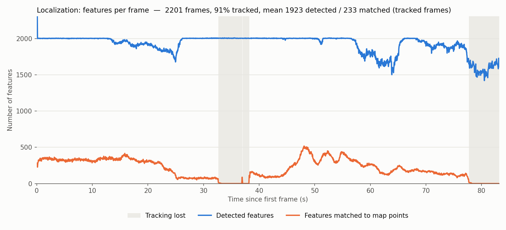
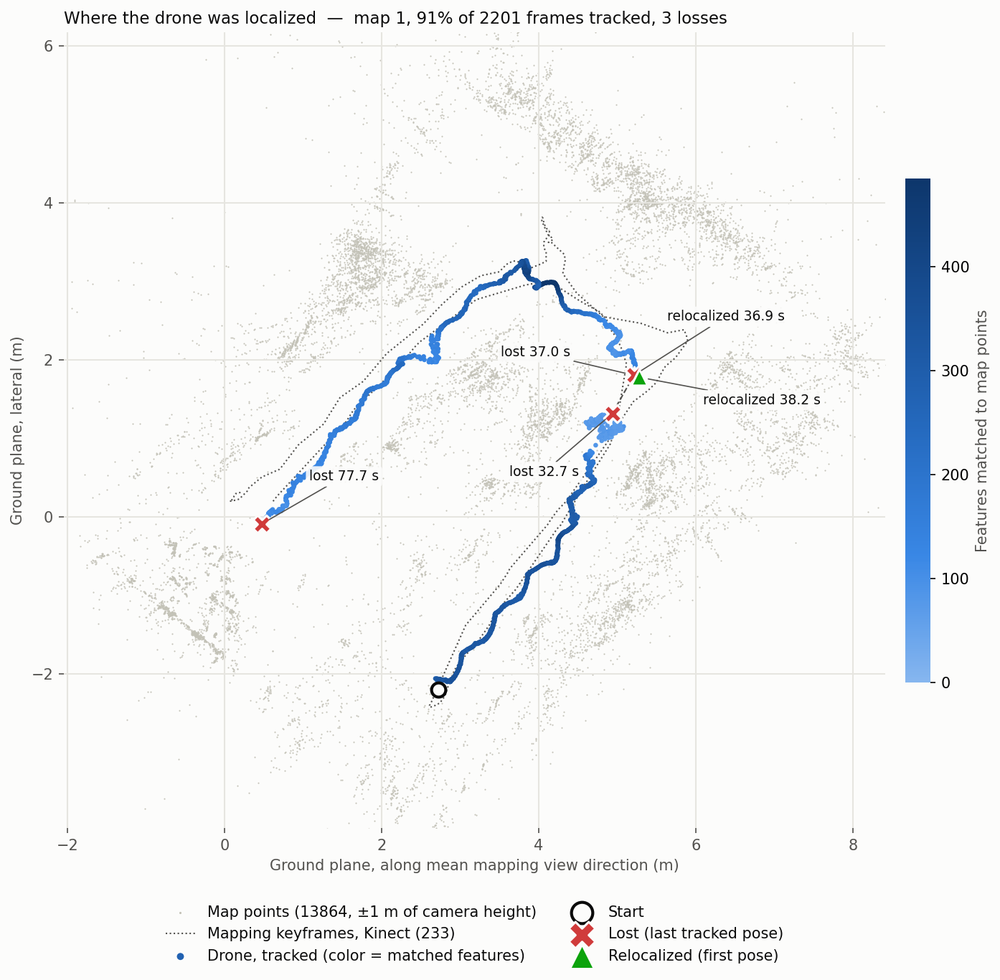

# Localization results: `tello_alpha` against `map_rgbd_04`

Monocular localization of the `tello_alpha` drone bag against `map_rgbd_04`,
the Kinect map rebuilt with the corrected `kinect.yaml` (RGB intrinsics from
the bag's `/camera_info`, `RGBD.DepthMapFactor: 1000`). Unlike `map_rgbd_03`
(see [`../tello_alpha_vs_map_rgbd_03`](../tello_alpha_vs_map_rgbd_03/README.md)),
this map is metric: its keyframes span 3.7 x 5.7 m instead of 0.7 x 1.1 m.

Setup: fork with relocalization in localization-only mode,
`tello_kinect_scale.yaml` (`tello_02` calibration, images resized to 549x413
so the Tello fx matches the Kinect fx of 526.6).

| | `map_rgbd_03` (5x too small) | `map_rgbd_04` (metric) |
|---|---|---|
| Tracked frames | 89% | **91%** |
| Mean matched features (tracked frames) | 229 | **233** |
| Losses | 34 s, 80 s | 33 s (+ a 1 s relapse at 37 s), 78 s |

2201 of the bag's 2577 frames reached the tracker in this run; the rest were
dropped while tracking was slower than the 30 fps playback.

## Files

| File | Content |
| --- | --- |
| `localization.csv` | Per frame: detected/matched features, tracking state and `T_world_camera` (x, y, z, quaternion xyzw). |
| `localization_keyframes.csv`, `localization_map_points.csv` | Keyframes and map points of the atlas. |
| `localization.png` | Detected and matched features over time. |
| `localization_map.png` | Top-down map with the drone trajectory and where tracking was lost. |

Re-plot with `plot_features.py` and `plot_localization_map.py` on
`localization.csv`.

## Features over time

- **Detected (blue):** ORB keypoints per frame, capped at 2000. Drops (60-65 s,
  after 78 s) mean less texture or blur in the image.
- **Matched (orange):** keypoints matched to map points as inliers; this is
  what localizes the drone. ~330 in the first 20 s, peaks of ~500 at 48 s.
- **Gray:** tracking lost.

## Where the drone was localized

- **Gray dots:** map points within ±1 m of the camera heights (floor and
  ceiling hidden). **Dotted line:** the Kinect mapping path (keyframes).
- **Trajectory:** drone poses while tracked, colored by matched features.
  **X:** last pose before a loss. **Triangle:** first pose after
  relocalization. **Dashed segment:** unknown motion while lost.

The drone flies the same route as the Kinect, starting at the bottom, going up
the right branch, turning at the top and coming down the left branch.

| Time | Drone position (m) | Matched | Distance to nearest Kinect keyframe |
| --- | --- | --- | --- |
| 0 s (start) | (2.7, -2.2) | 282 | 0.11 m |
| 20 s | (4.4, 0.2) | 306 | 0.04 m |
| 25 s | (4.7, 0.8) | 116 | 0.28 m |
| 32.6 s (lost) | (4.9, 1.3) | 58 | 0.11 m |
| 36.9 s (relocalized) | (5.2, 1.8) | 88 | 0.17 m |
| 48 s | (4.2, 3.0) | 505 | 0.02 m |
| 77.6 s (lost) | (0.5, -0.1) | 61 | 0.31 m |

## Interpretation

- **Matches follow the mapping path.** The most matches (~500 at 48 s) happen
  2 cm from a Kinect keyframe; they drop when the drone drifts ~0.3 m from the
  path or sees the scene from a different viewpoint.
- **Loss at 32.7 s (right branch, before the turn).** Matches fall from ~300
  to ~75 from 23 s on, while the camera faces the glass wall (see the key
  frames in the `map_rgbd_03` results): the far background seen through the
  glass is beyond the Kinect depth range and has no map points. With only
  ~75 inliers the pose gets noisy: the light-blue cluster around (4.8, 1.1),
  including a 0.5 m height jump at 28 s. It relocalizes at 36.9 s, 0.6 m
  further, loses track once more for ~1 s and then tracks the rest of the
  loop.
- **Loss at 77.7 s (end of the left branch).** The drone reaches the end of
  the Kinect path (0.3 m off it), with
  blurred frames and the camera close to a chair. There are no map points for
  that view, so it does not relocalize before the bag ends.
- **Corrected scale.** Localization quality is about the same as with
  `map_rgbd_03` (91% vs 89%), as expected since a uniformly scaled map matches
  the same way. The difference is that positions and distances are now metric,
  which Nav2 and flight commands need.

## Known limitation of the map

`bags/kinect` stores depth unregistered to the RGB camera (`kinect_depth`
frame, fx 587, vs RGB fx 527). ORB-SLAM3 assumes registered depth, so depth is
offset by up to ~33 px near the image borders and ~7 px from the camera
baseline at 1.8 m, which adds depth errors at object boundaries.
